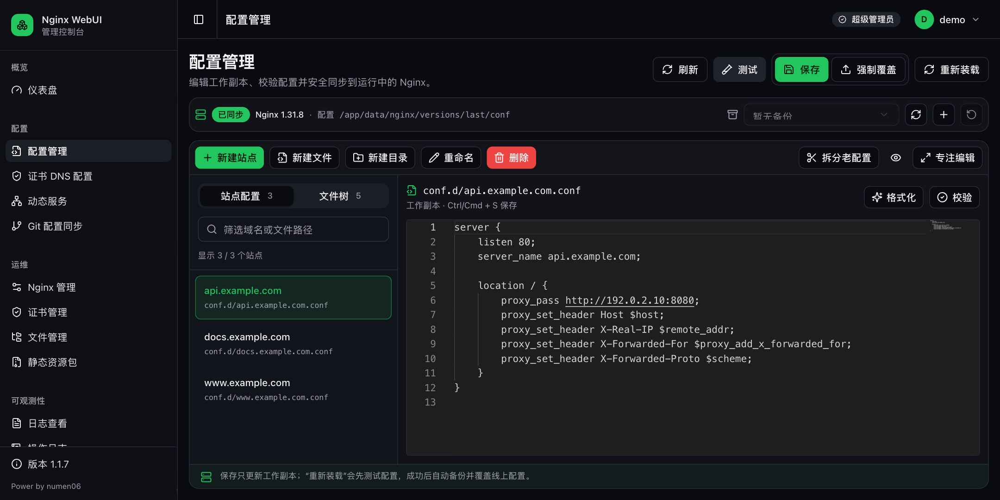

# Nginx WebUI

用浏览器管理 Nginx 站点、HTTPS 证书和日志。修改站点配置后，可以在页面里测试、重载，也可以从备份恢复。

## 用官方镜像快速开始

**推荐使用我们发布的 Docker 镜像。** 下面的命令会自动拉取 1.1.7，支持 amd64 和 arm64，镜像内置 Nginx 1.31.8。

在已安装 Docker 的服务器上运行，先确认 `80`、`443` 和 `8000` 端口可用。

```bash
docker run -d \
  --name nginx-webui \
  --restart unless-stopped \
  -p 80:80 \
  -p 443:443 \
  -p 8000:8000 \
  -v /opt/nginx-webui/data:/app/data \
  registry.cn-shanghai.aliyuncs.com/numen/nginx-webui:1.1.7
```

1. 打开 `http://服务器IP:8000`，用户名为 `admin`。在服务器终端运行以下命令查看初始密码。

   ```bash
   docker exec nginx-webui cat /app/data/backend/initial-admin-password
   ```

2. 登录后，在右上角进入 **用户中心** 设置自己的密码。
3. 首次启动时，容器会准备内置的 Nginx。如果出现 **Nginx 初始设置向导**，点击 **准备源码包**，等编译完成后点击 **发布到生产**，再到仪表盘确认 Nginx 已运行。

`80` 和 `443` 用于站点访问。`8000` 是管理端口，建议仅向管理网络开放。

## 日常怎么用

| 任务 | 在哪里操作 |
| --- | --- |
| 添加站点或修改反向代理 | **配置管理**。点击 **新建站点** 或选择已有站点。编辑后先 **保存**、再 **测试**，通过后点击 **重新装载**。需要恢复时，选择备份版本并点击 **回滚备份**。 |
| 给站点开 HTTPS | **证书管理**。点击 **申请证书** 或 **上传证书**。用 HTTP 验证时，域名需指向这台服务器，且公网可访问 `80`。通配符域名使用 DNS 验证。证书就绪后，在站点配置中引用证书，再测试并重载。 |
| 排查 404、502 或访问变慢 | 先在 **仪表盘** 查看运行状态和请求统计，再到 **日志查看** 按时间或关键词找出相关的访问日志和错误日志。 |
| 上传或编辑站点文件 | 打开 **文件管理**，可以浏览目录、上传、下载和编辑文件。 |
| 查看运行版本 | 登录后打开 **Nginx 管理**，查看实际运行版本和构建记录。 |

证书列表可以查看到期时间和自动续签状态。已有证书搬家时，可使用 [证书迁移与自动续签](docs/cert-migration.md)。

## 界面预览

以下截图使用 1.1.7 的界面和演示数据。

### 仪表盘


### 配置管理



### 证书管理


### 首次设置向导


## 备份和升级

配置、证书、账号和日志都保存在挂载的数据目录中。升级前备份 `/opt/nginx-webui/data`，再用新镜像重建容器，沿用原来的数据挂载和端口。WebUI 和正在运行的 Nginx 可分别升级，切换步骤见 [1.1.7 更新和升级说明](release-notes/1.1.7.md)。

如果刚启动时打不开页面，运行 `docker logs --tail 100 nginx-webui` 查看进度。首次启动需要一些时间准备 Nginx。

[本地开发指南](QUICKSTART.md) · [历史版本](release-notes/) · [MIT 许可证](LICENSE)
